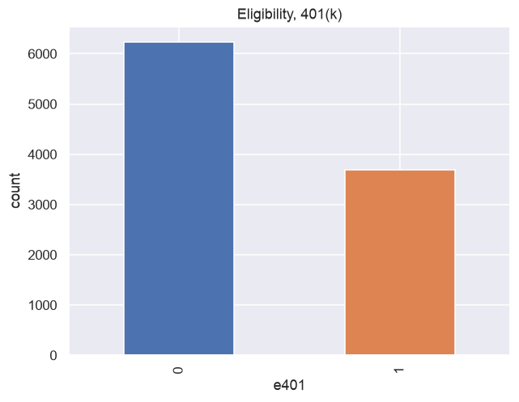
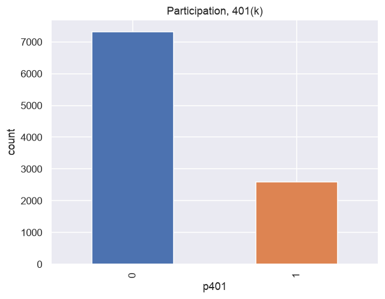
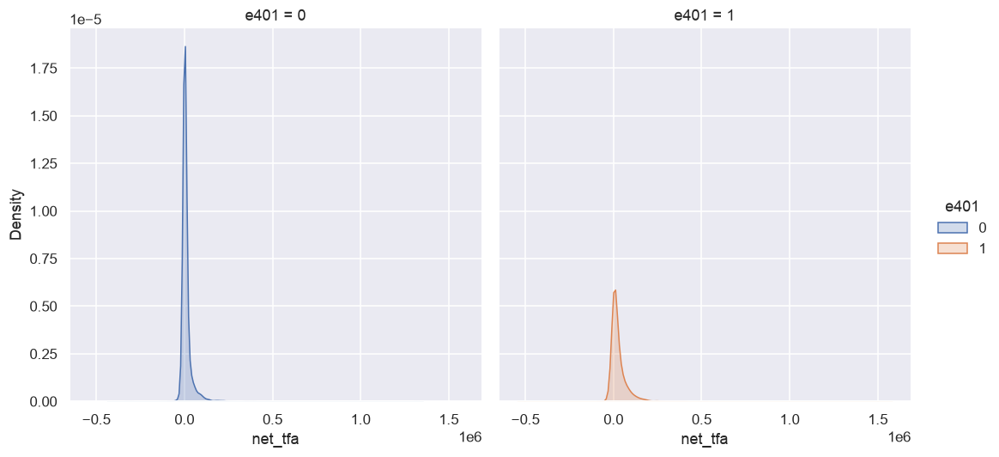
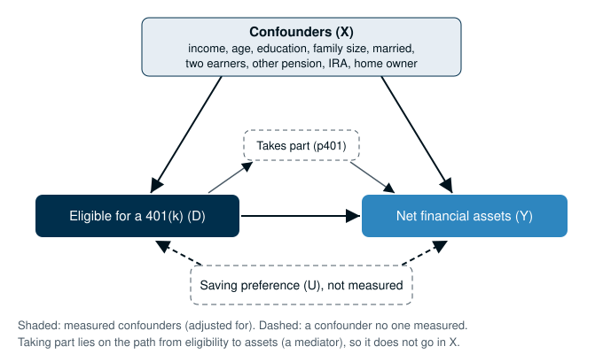

:::::::::::::::::::::::::::::::::::::: questions

- What causal question does the 401(k) example ask?
- Why can we not answer it by comparing eligible and non-eligible households?

::::::::::::::::::::::::::::::::::::::::::::::::

::::::::::::::::::::::::::::::::::::: objectives

- Name the treatment, the outcome and the confounders in the 401(k) example
- Load the data and compute the raw gap in net financial assets
- Show that eligibility and savings both rise with income
- Use a causal diagram to decide which variables belong in the adjustment set

::::::::::::::::::::::::::::::::::::::::::::::::

::::::::::::::::::::::::::::::::::::: callout

## From the masterclass

If you came to the masterclass, welcome back. This lesson picks up where Part 4 of the masterclass slides left off, and we will work through the same example in more depth. In this episode we go back over:

- slide 8, "A confounder affects both the treatment and the outcome";
- slide 10, "Two possible outcomes per household, and we only see one", and the Part 1 summary on slide 11;
- slide 21, "Which variables should we adjust for?";
- slide 29, "Our example: does a workplace pension increase household savings?".

All the code in this lesson follows DoubleML's own example, [Impact of 401(k) on Financial Wealth][doubleml-401k], which is available in both Python and R. Where code appears on a slide, you will find it here unchanged.

:::::::::::::::::::::::::::::::::::::::::::::::::

## The question

A 401(k) is a workplace pension in the United States. Employers do not have to offer one, and in 1991, when these data were collected, some did and some did not. The example asks:

> Did being eligible for a 401(k) raise a household's net financial assets?

In other words, if two households were alike in every way that matters except that one was eligible and the other was not, how much more would the eligible household hold?

::::::::::::::::::::::::::::::::::::: callout

## What is a 401(k), if you are not from the US?

A 401(k) is a retirement savings account offered through work, and it takes its name from the section of the US tax code that created it. Workers choose how much of their pay to put in, usually before tax, and many employers add a matching amount. As with Australian superannuation or a UK workplace pension, the money builds up in the worker's own account.

The difference for our purposes is that a 401(k) is optional. US employers choose whether to offer one, and in 1991, the year of our data, workers chose whether to join. Australian employers, by contrast, must pay at least 12% of wages into super, and UK employers have had to enrol eligible workers automatically since this was phased in from 2012, although workers can opt out. In this example, "eligible" means that the household's employer offered a 401(k) (slide 29).

:::::::::::::::::::::::::::::::::::::::::::::::::

We will use the notation from the slides:

- The **treatment** *D* is eligibility (`e401`), which is 1 if the household is eligible and 0 if it is not.
- The **outcome** *Y* is net financial assets in US dollars (`net_tfa`). This adds up bank accounts, savings bonds, stocks, and IRA and 401(k) balances, and subtracts non-mortgage debt.
- The **confounders** *X* are the things that affect both eligibility and savings. Here they are income, age, education, family size, marital status, whether there are two earners, whether someone has another (defined benefit) pension, IRA participation and home ownership.

## The data

The data cover 9,915 households from the 1991 Survey of Income and Program Participation, the same sample that Chernozhukov et al. (2018) used. Let's start with step 1 from the slides (slide 35):

```python
!pip install doubleml     # once per session
import numpy as np
import doubleml as dml
from doubleml.datasets import fetch_401K

data = fetch_401K(return_type='DataFrame')
print(data[['e401', 'net_tfa']]
      .groupby('e401').mean().diff())
```

```output
          net_tfa
e401             
0             NaN
1     19559.34475
```

The first line installs DoubleML. In Jupyter or Colab, a line that starts with `!` runs as a command outside Python. If you followed the [Setup](../learners/setup.md) page, DoubleML is already installed and pip will simply tell you so. `fetch_401K` downloads the data, so you will need an internet connection.

The last two lines compute the **raw gap**, which is the average net financial assets of eligible households minus the average for households that were not eligible. In the output, `diff()` puts that difference in the row for `1`, and you should see that eligible households held about $19,559 more.

Let's look at the variables we will use:

```python
print(data.shape)
data[['net_tfa', 'e401', 'p401', 'inc', 'age', 'educ', 'fsize']].describe().round(1)
```

```output
(9915, 14)
         net_tfa    e401    p401       inc     age    educ   fsize
count     9915.0  9915.0  9915.0    9915.0  9915.0  9915.0  9915.0
mean     18051.5     0.4     0.3   37200.6    41.1    13.2     2.9
std      63522.5     0.5     0.4   24774.3    10.3     2.8     1.5
min    -502302.0     0.0     0.0   -2652.0    25.0     1.0     1.0
25%       -500.0     0.0     0.0   19413.0    32.0    12.0     2.0
50%       1499.0     0.0     0.0   31476.0    40.0    12.0     3.0
75%      16524.5     1.0     1.0   48583.5    48.0    16.0     4.0
max    1536798.0     1.0     1.0  242124.0    64.0    18.0    13.0
```

The variable `p401` records whether the household actually **took part** in a 401(k). Only eligible households can take part, so `p401` is 1 for a subset of the eligible ones.

## Plotting the data

The DoubleML example uses seaborn for its plots, so we set that up first:

```python
import pandas as pd
import matplotlib.pyplot as plt
import seaborn as sns

sns.set()
colors = sns.color_palette()
```

How many households were eligible, and how many of them took part? We can plot eligibility first:

```python
data['e401'].value_counts().plot(kind='bar', color=colors)
plt.title('Eligibility, 401(k)')
plt.xlabel('e401')
_ = plt.ylabel('count')
plt.show()
```

{alt='Bar chart of eligibility: about 6,200 households not eligible and about 3,700 eligible.'}

Then we make the same plot for participation:

```python
data['p401'].value_counts().plot(kind='bar', color=colors)
plt.title('Participation, 401(k)')
plt.xlabel('p401')
_ = plt.ylabel('count')
plt.show()
```

{alt='Bar chart of participation: about 7,300 households not taking part and about 2,600 taking part.'}

You should see that 2,594 of the 3,682 eligible households took part. Next we plot the outcome, separately for households that were and were not eligible:

```python
_ = sns.displot(data, x="net_tfa", hue="e401", col="e401",
                kind="kde", fill=True)
plt.show()
```

{alt='Density of net financial assets for non-eligible (left) and eligible (right) households. Both are concentrated near zero with a long right tail; the tail is longer for eligible households.'}

Each curve shows how net financial assets are spread across households, and a curve is highest where households are most common. In both groups most households hold little and a few hold a great deal, but the curve for eligible households stretches further to the right.

The DoubleML example also computes the raw gap for taking part:

```python
print(data[['p401', 'net_tfa']].groupby('p401').mean().diff())
```

```output
           net_tfa
p401              
0              NaN
1     27371.582031
```

Households that took part held about $27,372 more than those that did not.

## Why does the raw gap mislead?

Eligibility came with the job, and better-paid jobs offered a 401(k) more often. Income also affects how much a household can save, whether or not it has a pension. This makes income a confounder (slide 8), because it pushes eligibility and savings up together. We can see this by splitting households into five income bands:

```python
bands = pd.qcut(data['inc'], 5, labels=['lowest', '2', '3', '4', 'highest'])
data.groupby(bands, observed=True)[['e401', 'net_tfa']].mean().astype(float).round(2)
```

```output
         e401   net_tfa
inc                    
lowest   0.13   1565.61
2        0.26   4713.01
3        0.38   9801.01
4        0.49  19138.48
highest  0.59  55039.57
```

Each row is a fifth of the households, ordered from the lowest incomes to the highest. The `e401` column gives the share that were eligible and `net_tfa` gives their average net financial assets. You should see both columns rise as income rises.

So the raw gap mixes the effect of eligibility with the fact that eligible households earn more and would have saved more anyway. The Part 1 summary on slide 11 put this into words by saying that a raw comparison mixes the effect with selection bias. Using the potential outcomes from slide 10, we can write it as

$$\underbrace{E[Y \mid D=1] - E[Y \mid D=0]}_{\text{raw gap}} = \underbrace{E[Y(1) - Y(0) \mid D=1]}_{\text{effect on the eligible}} + \underbrace{E[Y(0) \mid D=1] - E[Y(0) \mid D=0]}_{\text{selection bias}},$$

where *Y*(1) is what a household would hold if eligible and *Y*(0) is what the same household would hold if not. Every household has both, but we only ever see one of them. *E*[ ] means "the average of". The selection bias term is the difference between the two groups that has nothing to do with the pension, and in this example it is almost certainly positive.

## Which variables should we adjust for?

The argument behind the example comes from Poterba et al. (1995). Around 1991, they argue, people chose jobs for the pay and the work rather than for the 401(k), so *once income and a few other characteristics are held fixed*, eligibility is close to as good as random. This is a claim about the causal diagram below, and we have no way to prove it from the data.

{alt='Causal diagram. Confounders X point to eligibility D and to net financial assets Y. D points to Y directly and through taking part (p401). An unmeasured saving preference U, drawn dashed, points to both D and Y.'}

In a causal diagram, an arrow means "causes". The nine confounders in *X* point to both eligibility and assets, so they open a back-door path (eligibility ← *X* → assets), and we close that path by adjusting for *X*. The dashed box is a confounder that nobody measured.

::::::::::::::::::::::::::::::::::::: challenge

## Challenge 1: should participation go in X?

The data include `p401` (taking part). Should it be one of the confounders?

:::::::::::::::::::::::: solution

No. Eligibility causes taking part, since only eligible households can take part, and taking part changes savings. That puts `p401` on the path from the treatment to the outcome, which makes it a **mediator**. If we adjusted for it, we would remove the part of the effect that works through taking part, and that is most of it. A mediator is one kind of bad control (Cinelli et al., 2024). Another kind is a **collider**, something caused by both the treatment and the outcome (slide 21). Adjusting for a collider creates a link between them that is not really there.

:::::::::::::::::::::::::::::::::

::::::::::::::::::::::::::::::::::::::::::::::::

::::::::::::::::::::::::::::::::::::: challenge

## Challenge 2: what is missing?

Think of one thing that could affect both eligibility and savings but does not appear in the data.

:::::::::::::::::::::::: solution

The DoubleML example names one, a **preference for saving**. People who like to save may have looked for jobs that offered a pension, and they would hold more assets anyway. No variable in the survey measures this preference, so no method that adjusts for *X* can remove it. In episode 5 we will ask how strong a confounder like this would need to be to change the answer.

:::::::::::::::::::::::::::::::::

::::::::::::::::::::::::::::::::::::::::::::::::

::::::::::::::::::::::::::::::::::::: keypoints

- The treatment is 401(k) eligibility (`e401`), the outcome is net financial assets (`net_tfa`), and the nine confounders include income, age and education.
- Eligible households held $19,559 more on average, but eligibility and savings both rise with income, so this raw gap mixes the effect with selection bias.
- A causal diagram tells us what goes in *X*: confounders go in, and mediators such as taking part (`p401`) stay out.
- Adjusting for *X* cannot remove a confounder that was never measured, such as a preference for saving.

::::::::::::::::::::::::::::::::::::::::::::::::
