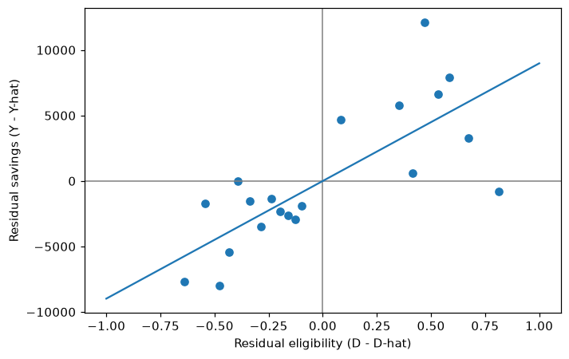

:::::::::::::::::::::::::::::::::::::: questions

- How do two predictions and one regression cut a confounder out of the comparison?
- What does a residual mean for one household?
- Why does each household's prediction come from a model that never saw it?

::::::::::::::::::::::::::::::::::::::::::::::::

::::::::::::::::::::::::::::::::::::: objectives

- Predict savings and eligibility from the confounders with random forests, using cross-fitting
- Compute the residuals and estimate the effect as the slope of one on the other
- Check that with straight-line predictions the same steps give the ordinary regression coefficient
- Show what goes wrong when a flexible model predicts the households it was trained on

::::::::::::::::::::::::::::::::::::::::::::::::

::::::::::::::::::::::::::::::::::::: callout

## From the masterclass

In this episode we build by hand what the slides showed in pictures:

- slide 30, "How DML cuts the confounder out" (model 1 predicts savings, model 2 predicts eligibility, and each keeps only the residual, actual minus predicted);
- slide 31, the same four steps with smoking, exercise and heart disease;
- slide 32, one household's residuals, the final regression $Y - \hat{Y} = \theta(D - \hat{D}) + \varepsilon$, and its slope across all households;
- slide 33, "Cross-fitting: models never predict households they trained on".

A **residual** is actual minus predicted: what is left over once the prediction is taken away. That is why the chart on slide 32 and slide 33 call them "leftovers". It is the same thing, and in this lesson we say residual.

In episode 3 DoubleML will do all of this in a few lines, so working through it once by hand here should make it easier to see what those lines are doing.

:::::::::::::::::::::::::::::::::::::::::::::::::

## Set up

If you are continuing from episode 1 in the same notebook, `data` is already loaded. Either way, run the following:

```python
!pip install doubleml     # once per session
import numpy as np
import pandas as pd
import matplotlib.pyplot as plt
from doubleml.datasets import fetch_401K
from sklearn.ensemble import RandomForestRegressor, RandomForestClassifier
from sklearn.model_selection import KFold, cross_val_predict

data = fetch_401K(return_type='DataFrame')
features_base = ['age', 'inc', 'educ', 'fsize', 'marr',
                 'twoearn', 'db', 'pira', 'hown']
X = data[features_base]
y = data['net_tfa']
d = data['e401']
```

## Step A: predict savings from the confounders

Our first machine learning model predicts each household's net financial assets from the nine confounders alone, without being told whether the household was eligible. We use the random forest settings from the DoubleML example (slide 37).

Each household's prediction has to come from a model that was not trained on that household. `KFold` splits the households into three parts, and `cross_val_predict` trains on two parts and predicts the third, three times over. This is called **cross-fitting** (slide 33), and we can set it up as follows:

```python
randomForest = RandomForestRegressor(
    n_estimators=500, max_depth=7, max_features=3, min_samples_leaf=3, random_state=0)
folds = KFold(n_splits=3, shuffle=True, random_state=123)

y_hat = cross_val_predict(randomForest, X, y, cv=folds)
y_resid = y - y_hat
```

`y_hat` is $\hat{Y}$, the savings we would expect given the confounders, and `y_resid` is the residual $Y - \hat{Y}$. In other words, `y_resid` tells us how much more (or less) a household holds than other households like it.

## Step B: predict eligibility from the confounders

The second model predicts eligibility from the same confounders. Eligibility is yes or no, so we use a classifier and ask it for the probability of being eligible, which is the second column that `method='predict_proba'` returns:

```python
randomForest_class = RandomForestClassifier(
    n_estimators=500, max_depth=5, max_features=4, min_samples_leaf=7, random_state=0)

d_hat = cross_val_predict(randomForest_class, X, d, cv=folds,
                          method='predict_proba')[:, 1]
d_resid = d - d_hat
```

`d_hat` is $\hat{D}$, the chance that a household like this one is eligible, and `d_resid` is $D - \hat{D}$. For an eligible household `d_resid` is positive, meaning it is more eligible than expected, and for a household that is not eligible it is negative.

## What do the residuals mean for three households?

Let's put the predictions and residuals side by side for the first three households:

```python
pd.DataFrame({'net_tfa': y, 'y_hat': y_hat, 'y_resid': y_resid,
              'e401': d, 'd_hat': d_hat, 'd_resid': d_resid}).head(3).round(2)
```

```output
   net_tfa    y_hat   y_resid  e401  d_hat  d_resid
0      0.0  3356.01 -3356.01     0   0.09   -0.09
1   1015.0  7370.83 -6355.83     0   0.30   -0.30
2  -2000.0   143.99 -2143.99     0   0.39   -0.39
```

Take the second household as an example. Given its income, age and so on, the first model expects it to hold about $7,371, but it actually holds $1,015, so its residual savings are about −$6,356. The second model gives a household like this a 30% chance of being eligible. This household is not eligible, so its residual eligibility is 0 − 0.30 = −0.30.

## Step C: one regression

The final step asks whether households that are more eligible than expected also save more than expected. We answer that with the slope of `y_resid` on `d_resid`. With one predictor and no intercept, the least squares slope is the sum of the products divided by the sum of squares, which we can compute directly:

```python
theta_hat = (d_resid @ y_resid) / (d_resid @ d_resid)
print(f"Effect of eligibility, by hand: ${theta_hat:,.0f}")
```

```output
Effect of eligibility, by hand: $8,984
```

This is close to the $8,910 that DoubleML reports in episode 3. The two are not identical because DoubleML draws its own three folds and its forests make their own random choices. In episode 4 we will see that the choice of model moves the answer by more than this.

The chart on slide 32 plotted DoubleML's residuals for all 9,915 households, sorted into 20 groups. We can draw the same chart with our own residuals:

```python
groups = pd.qcut(d_resid, 20, labels=False)
binned = pd.DataFrame({'d_resid': d_resid, 'y_resid': y_resid}).groupby(groups).mean()

fig, ax = plt.subplots(figsize=(7, 4.5))
ax.axhline(0, color='grey', lw=1)
ax.axvline(0, color='grey', lw=1)
ax.scatter(binned.d_resid, binned.y_resid)
xs = np.array([-1, 1])
ax.plot(xs, theta_hat * xs)
ax.set_xlabel('Residual eligibility (D - D-hat)')
ax.set_ylabel('Residual savings (Y - Y-hat)')
plt.show()
```

{alt='Scatter plot of 20 group averages of residual savings against residual eligibility, with a straight line through the origin. Points left of zero (not eligible) mostly sit below zero, and points right of zero (eligible) mostly sit above it.'}

Each dot is the average for about 500 households with similar residual eligibility. Dots to the left of zero are households that were not eligible, and dots to the right of zero are households that were. The slope of the line is the effect.

## Why the slope of the residuals is the effect

Slide 32 wrote the final regression as $Y - \hat{Y} = \theta(D - \hat{D}) + \varepsilon$. This regression comes from the **partially linear model**, which slide 38 names:

$$Y = \theta D + g(X) + \varepsilon,$$

where θ is the effect of eligibility and *g*(*X*) is everything the confounders do to savings, whatever its shape. Model 1's prediction, $\hat{Y}$, is the average savings of households with the same *X*, and model 2's prediction, $\hat{D}$, is their average eligibility. If we average both sides of the model over households with the same *X*, ε averages to zero and we get:

$$\hat{Y} = \theta \hat{D} + g(X).$$

If we subtract this second equation from the first, *g*(*X*) cancels and we are left with:

$$Y - \hat{Y} = \theta (D - \hat{D}) + \varepsilon.$$

So regressing residual savings on residual eligibility estimates θ, whatever shape *g* takes. The machine learning models only have to predict well, and they never have to tell us what *g* looks like.

## With straight lines, this is ordinary regression

Steps A to C are older than they look. Frisch and Waugh (1933) showed that if both predictions come from ordinary linear regression, the slope in step C is exactly the coefficient on eligibility from a multiple regression of savings on eligibility and the nine confounders. In other words, when a regression "controls for" *X*, it is doing these three steps behind the scenes. We can check this by using linear regression for both predictions, fitted on all the data:

```python
import statsmodels.formula.api as smf
from sklearn.linear_model import LinearRegression

y_resid_lin = y - LinearRegression().fit(X, y).predict(X)
d_resid_lin = d - LinearRegression().fit(X, d).predict(X)
print(f"Slope of the residuals:     ${(d_resid_lin @ y_resid_lin) / (d_resid_lin @ d_resid_lin):,.2f}")

ols = smf.ols('net_tfa ~ e401 + ' + ' + '.join(features_base), data=data).fit()
print(f"Multiple regression for e401: ${ols.params['e401']:,.2f}")
```

```output
Slope of the residuals:     $5,896.20
Multiple regression for e401: $5,896.20
```

You should see the same figure on both lines, and this is what "holding the other variables constant" means in a regression. DML keeps this logic and swaps the straight lines for flexible models. The regression's $5,896 is lower than the forests' estimate, probably because a straight line in income cannot follow how savings actually rise with income. We will come back to this in episode 4.

## Why do we need cross-fitting?

Suppose we skip cross-fitting and let a very flexible forest, with no depth limit and leaves of one household, predict the same households it was trained on:

```python
flexible = RandomForestRegressor(n_estimators=500, min_samples_leaf=1, random_state=0)
flexible_class = RandomForestClassifier(n_estimators=500, min_samples_leaf=1, random_state=0)

y_resid_in = y - flexible.fit(X, y).predict(X)
d_resid_in = d - flexible_class.fit(X, d).predict_proba(X)[:, 1]
print(f"Residual savings, as a share of the variance of savings: {y_resid_in.var() / y.var():.2f}")
print(f"Effect without cross-fitting: ${(d_resid_in @ y_resid_in) / (d_resid_in @ d_resid_in):,.0f}")
```

```output
Residual savings, as a share of the variance of savings: 0.11
Effect without cross-fitting: $9,629
```

The forest appears to "explain" almost 90% of the variation in savings. Income and the other confounders cannot really predict savings that well. The forest has partly memorised the households, so their residuals have shrunk towards zero. The estimate is built from those shrunken residuals, and the theory behind DML's confidence interval no longer applies to it.

::::::::::::::::::::::::::::::::::::: challenge

## Challenge: the same flexible forests, with cross-fitting

Repeat the last block, but this time get the predictions with `cross_val_predict(..., cv=folds)`, as we did in steps A and B. What share of the variance of savings is left over now, and what is the estimate? Fill in the blanks below. In this and every later exercise, replace each `____` with your answer before you run the cell: Python reads the blank as a name, so running it unchanged gives `NameError: name '____' is not defined`.

```python
y_resid_cf = y - cross_val_predict(flexible, X, y, cv=____)
d_resid_cf = d - cross_val_predict(flexible_class, X, d, cv=____, method='predict_proba')[:, 1]
print(f"Residual share: {y_resid_cf.var() / y.var():.2f}")
print(f"Effect with cross-fitting: ${(d_resid_cf @ y_resid_cf) / (d_resid_cf @ d_resid_cf):,.0f}")
```

:::::::::::::::::::::::: solution

```python
y_resid_cf = y - cross_val_predict(flexible, X, y, cv=folds)
d_resid_cf = d - cross_val_predict(flexible_class, X, d, cv=folds, method='predict_proba')[:, 1]
print(f"Residual share: {y_resid_cf.var() / y.var():.2f}")
print(f"Effect with cross-fitting: ${(d_resid_cf @ y_resid_cf) / (d_resid_cf @ d_resid_cf):,.0f}")
```

```output
Residual share: 0.84
Effect with cross-fitting: $9,269
```

With cross-fitting, 84% of the variation in savings is left over, compared with 11% before. Income and the other confounders predict savings only partly, and the residuals now reflect that. A model cannot memorise a household it never saw, which is why DoubleML always cross-fits.

The estimate of $9,269 is still a little higher than the $8,984 we got in steps A to C. These unrestricted forests are noisier than the tuned ones from the DoubleML example, and the choice of model moves the answer, which is what episode 4 is about.

:::::::::::::::::::::::::::::::::

::::::::::::::::::::::::::::::::::::::::::::::::

::::::::::::::::::::::::::::::::::::: keypoints

- DML predicts the outcome from the confounders, predicts the treatment from the confounders, and takes the slope of one set of residuals on the other as the effect.
- A residual is how far a household is from what the confounders predict, in savings or in eligibility, compared with households like it.
- With straight-line predictions the slope equals the multiple regression coefficient (Frisch and Waugh, 1933), and DML swaps in flexible models for the straight lines.
- Each prediction must come from a model that did not see that household (cross-fitting), because otherwise flexible models memorise the data and shrink the residuals.

::::::::::::::::::::::::::::::::::::::::::::::::
