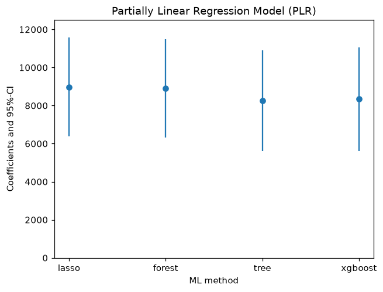

:::::::::::::::::::::::::::::::::::::: questions

- Does the answer depend on which machine learning model we use?
- Why does lasso need help from squared terms?

::::::::::::::::::::::::::::::::::::::::::::::::

::::::::::::::::::::::::::::::::::::: objectives

- Fit the partially linear model with lasso, a random forest, a decision tree and boosting
- Explain why lasso with the raw variables gives a lower estimate than lasso with squared terms
- Summarise the four estimates in a table and a chart, and decide how to report them

::::::::::::::::::::::::::::::::::::::::::::::::

::::::::::::::::::::::::::::::::::::: callout

## From the masterclass

Slide 40, "You can then repeat the DML process, but change the ML method", showed the chart you will make at the end of this episode. It also suggested reporting the spread across learners as a form of sensitivity analysis. In this episode we fit each learner in turn and see why lasso needs extra terms, following the DoubleML example cell by cell.

:::::::::::::::::::::::::::::::::::::::::::::::::

## Set up

We start with the imports from the DoubleML example, followed by the data and the data object from episode 3. We have added three lines of our own. The first installs DoubleML if it is not there already, for example in a fresh Colab notebook. The `warnings` filter hides notices from scikit-learn saying that the lasso classifier's `penalty` argument will change in a future version (with the versions pinned for this lesson it works as it should). The `display.width` line stops pandas from hiding columns of the summaries.

```python
!pip install doubleml     # once per session
import warnings
warnings.filterwarnings('ignore', category=FutureWarning)  # scikit-learn notices about future versions

import numpy as np
import pandas as pd
import doubleml as dml
from doubleml.datasets import fetch_401K

from sklearn.preprocessing import PolynomialFeatures
from sklearn.linear_model import LassoCV, LogisticRegressionCV
from sklearn.ensemble import RandomForestClassifier, RandomForestRegressor
from sklearn.tree import DecisionTreeClassifier, DecisionTreeRegressor
from sklearn.preprocessing import StandardScaler
from sklearn.pipeline import make_pipeline

from xgboost import XGBClassifier, XGBRegressor

import matplotlib.pyplot as plt
import seaborn as sns

pd.set_option('display.width', 120)
data = fetch_401K(return_type='DataFrame')

# Set up basic model: Specify variables for data-backend
features_base = ['age', 'inc', 'educ', 'fsize', 'marr',
                 'twoearn', 'db', 'pira', 'hown']

# Initialize DoubleMLData (data-backend of DoubleML)
data_dml_base = dml.DoubleMLData(data,
                                 y_col='net_tfa',
                                 d_cols='e401',
                                 x_cols=features_base)
```

If `from xgboost import ...` fails on a Mac with a message about `libomp`, have a look at the [Setup](../learners/setup.md) page.

## Lasso

**Lasso** is a linear regression that shrinks small coefficients towards zero and drops some variables altogether. We need two lasso models, `LassoCV` for savings and a penalised logistic regression for eligibility. Both choose how hard to shrink by five-fold cross-validation, and both need the variables on the same scale, which is why each pipeline starts with `StandardScaler`:

```python
# Initialize learners
Cs = 0.0001*np.logspace(0, 4, 10)
lasso = make_pipeline(StandardScaler(), LassoCV(cv=5, max_iter=10000))
lasso_class = make_pipeline(StandardScaler(),
                            LogisticRegressionCV(cv=5, penalty='l1', solver='liblinear',
                                                 Cs = Cs, max_iter=1000))

np.random.seed(123)
# Initialize DoubleMLPLR model
dml_plr_lasso = dml.DoubleMLPLR(data_dml_base,
                                ml_l = lasso,
                                ml_m = lasso_class,
                                n_folds = 3)

dml_plr_lasso.fit(store_predictions=True)
print(dml_plr_lasso.summary)
```

```output
             coef      std err         t     P>|t|        2.5 %       97.5 %
e401  5722.474647  1380.619171  4.144861  0.000034  3016.510795  8428.438499
```

Lasso gives about $5,722, well below the $8,910 we got from the random forest in episode 3. Lasso fits straight lines, so it treats each extra $1,000 of income as adding the same amount to savings at every income level. Savings rise faster than that at higher incomes, and whatever the straight line misses stays in the residuals as confounding.

The DoubleML example deals with this by giving lasso squared terms for the four continuous confounders, so that it can draw curves. The code below builds a **flexible** data object with age, age², income, income² and so on:

```python
# Set up a model according to regression formula with polynomials
features = data.copy()[['marr', 'twoearn', 'db', 'pira', 'hown']]

poly_dict = {'age': 2,
             'inc': 2,
             'educ': 2,
             'fsize': 2}
for key, degree in poly_dict.items():
    poly = PolynomialFeatures(degree, include_bias=False)
    data_transf = poly.fit_transform(data[[key]])
    x_cols = poly.get_feature_names_out([key])
    data_transf = pd.DataFrame(data_transf, columns=x_cols)
    
    features = pd.concat((features, data_transf),
                          axis=1, sort=False)
model_data = pd.concat((data.copy()[['net_tfa', 'e401']], features.copy()),
                        axis=1, sort=False)

# Initialize DoubleMLData (data-backend of DoubleML)
data_dml_flex = dml.DoubleMLData(model_data, y_col='net_tfa', d_cols='e401')
```

```python
print(data_dml_flex)
```

```output
================== DoubleMLData Object ==================

------------------ Data summary      ------------------
Outcome variable: net_tfa
Treatment variable(s): ['e401']
Covariates: ['marr', 'twoearn', 'db', 'pira', 'hown', 'age', 'age^2', 'inc', 'inc^2', 'educ', 'educ^2', 'fsize', 'fsize^2']
Instrument variable(s): None
No. Observations: 9915
------------------ DataFrame info    ------------------
<class 'pandas.DataFrame'>
RangeIndex: 9915 entries, 0 to 9914
Columns: 15 entries, net_tfa to fsize^2
dtypes: float32(3), float64(6), int8(6)
memory usage: 639.2 KB
```

Now we can fit lasso again, this time on the flexible data:

```python
# Estimate the ATE in the flexible model with lasso

np.random.seed(123)
dml_plr_lasso = dml.DoubleMLPLR(data_dml_flex,
                                ml_l = lasso,
                                ml_m = lasso_class,
                                n_folds = 3)

dml_plr_lasso.fit(store_predictions=True)
lasso_summary = dml_plr_lasso.summary

print(lasso_summary)
```

```output
             coef      std err         t         P>|t|        2.5 %        97.5 %
e401  8974.791097  1324.323636  6.776887  1.227932e-11  6379.164467  11570.417727
```

With the squared terms, lasso gives about $8,975, which is close to the random forest. Lasso can only work with the variables we hand it, while random forests and boosting find curves without being told.

## Random forest

These are steps 3 and 4 from episode 3, laid out as in the DoubleML example:

```python
# Random Forest
randomForest = RandomForestRegressor(
    n_estimators=500, max_depth=7, max_features=3, min_samples_leaf=3)
randomForest_class = RandomForestClassifier(
    n_estimators=500, max_depth=5, max_features=4, min_samples_leaf=7)

np.random.seed(123)
dml_plr_forest = dml.DoubleMLPLR(data_dml_base,
                                 ml_l = randomForest,
                                 ml_m = randomForest_class,
                                 n_folds = 3)
dml_plr_forest.fit(store_predictions=True)
forest_summary = dml_plr_forest.summary

print(forest_summary)
```

```output
             coef      std err         t         P>|t|        2.5 %        97.5 %
e401  8909.634078  1321.822289  6.740417  1.579322e-11  6318.909997  11500.358158
```

You should get the same $8,910 as in episode 3.

::::::::::::::::::::::::::::::::::::: challenge

## Challenge 1: a single decision tree

Fit the model with one decision tree for each prediction, using the settings from the example. The `ccp_alpha` argument prunes the tree, while `min_samples_split` and `min_samples_leaf` stop it splitting small groups. Fill in the two learners by replacing each `____` with one of the two models (one predicts savings, the other eligibility) before you run the cell:

```python
# Trees
trees = DecisionTreeRegressor(
    max_depth=30, ccp_alpha=0.0047, min_samples_split=203, min_samples_leaf=67)
trees_class = DecisionTreeClassifier(
    max_depth=30, ccp_alpha=0.0042, min_samples_split=104, min_samples_leaf=34)

np.random.seed(123)
dml_plr_tree = dml.DoubleMLPLR(data_dml_base,
                               ml_l = ____,
                               ml_m = ____,
                               n_folds = 3)
dml_plr_tree.fit(store_predictions=True)
tree_summary = dml_plr_tree.summary

print(tree_summary)
```

:::::::::::::::::::::::: solution

```python
# Trees
trees = DecisionTreeRegressor(
    max_depth=30, ccp_alpha=0.0047, min_samples_split=203, min_samples_leaf=67)
trees_class = DecisionTreeClassifier(
    max_depth=30, ccp_alpha=0.0042, min_samples_split=104, min_samples_leaf=34)

np.random.seed(123)
dml_plr_tree = dml.DoubleMLPLR(data_dml_base,
                               ml_l = trees,
                               ml_m = trees_class,
                               n_folds = 3)
dml_plr_tree.fit(store_predictions=True)
tree_summary = dml_plr_tree.summary

print(tree_summary)
```

```output
            coef      std err         t         P>|t|        2.5 %        97.5 %
e401  8260.06428  1348.624798  6.124805  9.079458e-10  5616.808246  10903.320314
```

A single tree gives about $8,260. Its predictions move in a few dozen steps, so its residuals keep a little more of the confounding than the forest's do, though the estimate still lands in the same range.

:::::::::::::::::::::::::::::::::

::::::::::::::::::::::::::::::::::::::::::::::::

::::::::::::::::::::::::::::::::::::: challenge

## Challenge 2: boosting

Now try boosted trees from the XGBoost library. As slide 26 showed, boosting grows trees in sequence, with each tree fixing the mistakes of the one before. Here `eta` is the learning rate and `n_estimators` is the number of trees. Fill in the two learners by replacing each `____` with one of the two models before you run the cell:

```python
# Boosted Trees
boost = XGBRegressor(n_jobs=1, objective = "reg:squarederror",
                     eta=0.1, n_estimators=35)
boost_class = XGBClassifier(use_label_encoder=False, n_jobs=1,
                            objective = "binary:logistic", eval_metric = "logloss",
                            eta=0.1, n_estimators=34)

np.random.seed(123)
dml_plr_boost = dml.DoubleMLPLR(data_dml_base,
                                ml_l = ____,
                                ml_m = ____,
                                n_folds = 3)
dml_plr_boost.fit(store_predictions=True)
boost_summary = dml_plr_boost.summary

print(boost_summary)
```

:::::::::::::::::::::::: solution

```python
# Boosted Trees
boost = XGBRegressor(n_jobs=1, objective = "reg:squarederror",
                     eta=0.1, n_estimators=35)
boost_class = XGBClassifier(use_label_encoder=False, n_jobs=1,
                            objective = "binary:logistic", eval_metric = "logloss",
                            eta=0.1, n_estimators=34)

np.random.seed(123)
dml_plr_boost = dml.DoubleMLPLR(data_dml_base,
                                ml_l = boost,
                                ml_m = boost_class,
                                n_folds = 3)
dml_plr_boost.fit(store_predictions=True)
boost_summary = dml_plr_boost.summary

print(boost_summary)
```

```output
             coef      std err         t         P>|t|        2.5 %        97.5 %
e401  8336.661463  1391.026647  5.993172  2.057874e-09  5610.299334  11063.023593
```

Boosting gives about $8,337. Recent versions of XGBoost may print a warning that `use_label_encoder` is not used. The argument is left over from older versions and does no harm, so you can ignore the warning.

:::::::::::::::::::::::::::::::::

::::::::::::::::::::::::::::::::::::::::::::::::

## Putting the four together

Let's collect the four summaries into one table. This uses `tree_summary` and `boost_summary` from the two challenges, so if you skipped them, run their solutions first:

```python
plr_summary = pd.concat((lasso_summary, forest_summary, tree_summary, boost_summary))
plr_summary.index = ['lasso', 'forest', 'tree', 'xgboost']
print(plr_summary[['coef', '2.5 %', '97.5 %']])
```

```output
                coef        2.5 %        97.5 %
lasso    8974.791097  6379.164467  11570.417727
forest   8909.634078  6318.909997  11500.358158
tree     8260.064280  5616.808246  10903.320314
xgboost  8336.661463  5610.299334  11063.023593
```

We can show the same numbers as a chart with error bars:

```python
errors = np.full((2, plr_summary.shape[0]), np.nan)
errors[0, :] = plr_summary['coef'] - plr_summary['2.5 %']
errors[1, :] = plr_summary['97.5 %'] - plr_summary['coef']
plt.errorbar(plr_summary.index, plr_summary.coef, fmt='o', yerr=errors)
plt.ylim([0, 12500])

plt.title('Partially Linear Regression Model (PLR)')
plt.xlabel('ML method')
_ =  plt.ylabel('Coefficients and 95%-CI')
plt.show()
```

{alt='Dot and whisker chart of the four PLR estimates of the effect of eligibility: lasso about 9,000, forest about 8,900, tree about 8,300 and xgboost about 8,300 dollars, each with a 95% confidence interval roughly from 5,600 to 11,600.'}

Each dot in the chart is one estimate of the effect of eligibility, and each line is its 95% confidence interval. You should see that the four estimates lie between about $8,260 and $8,975, and that their intervals overlap almost entirely.

::::::::::::::::::::::::::::::::::::: discussion

## Which number would you report?

The four estimates differ by about $700, which is around half a standard error. Good practice is to choose the main specification *before* you see the results, report it, and show the others alongside it, as the DoubleML example does. If you pick the number you like best after the fact, the robustness check turns into a search for significance.

Keep the lasso with raw variables ($5,722) in mind as well. A learner that cannot follow the shape of the confounders leaves confounding behind, and nothing in the output will warn you about it.

::::::::::::::::::::::::::::::::::::::::::::::::

::::::::::::::::::::::::::::::::::::: keypoints

- DoubleML accepts any scikit-learn-style model for the two predictions, `ml_l` for the outcome and `ml_m` for the treatment.
- On the 401(k) data, lasso with squared terms, a random forest, a decision tree and boosting give estimates from $8,260 to $8,975.
- Lasso with only the raw variables gives $5,722, probably because its straight lines miss the curve in income and the confounding they miss stays in the estimate.
- It is good practice to choose the main estimate in advance and report the other learners' estimates alongside it.

::::::::::::::::::::::::::::::::::::::::::::::::
